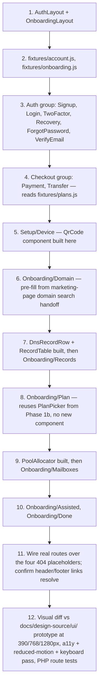

# Ziroemail — Auth, Checkout, Setup & Onboarding Build Spec (Phase 1c)

Status: ready to start · Builds on `MARKETING_BUILD.md` (Phase 1a/1b, shipped) · Scope: the 15 screens between the marketing site and the dashboards, UI-first on fixtures, no backend

This is the same kind of document as `MARKETING_BUILD.md` — scoped to exactly this phase so the build doesn't have to hold the dashboard phase or the backend in context. Read this file and `ARCHITECTURE.md` §4.2–4.5 (component/layout conventions); the backend sections of `ARCHITECTURE.md` (§5 onward) are background only, not in scope yet.

---

## 1. Why this phase, and what carries over

Per the 2026-10-16 progress report, the public marketing site (14 screens) is done, redesigned, and live. What's left before the dashboards is 15 screens in four groups: sign-in/sign-up, checkout, phone setup, and the onboarding wizard. The report's own recommendation — build these UI-first on fixtures, same component approach as the marketing pages, decide pricing/data model after — is what this document locks in.

**Reuse, don't rebuild:** the design-system work from Phase 1b already produced most of what this phase needs — `tokens.css`, Button, Card, Modal, Toast, Pill, Field, ChipGroup, Stepper, Callout, DomainPoolCard, SetupSteps, PlanPicker, Reveal. Audit that component set before writing anything new; several of these screens are variations on components that already exist (the onboarding stepper reuses `SetupSteps`/`Stepper`; the mailbox pool-allocation screen extends `DomainPoolCard`).

---

## 2. Decisions locked in for this phase

| # | Question | Decision |
|---|---|---|
| 1 | Backend this phase? | **No.** No Sanctum, no 2FA backend, no Paystack, no DNS resolver, no Mailcow calls. Every screen is fixture-driven, same contract as `fixtures/plans.js` in Phase 1b. |
| 2 | Pricing model | **Still deferred**, per Phase 1b. Checkout and the onboarding plan step read from `fixtures/plans.js` exactly as the Pricing page does. Do not resolve the pricing-model question as part of this phase. |
| 3 | Domain search → onboarding flow | **Assumption: a domain that passes the marketing-page domain-search check goes straight into the onboarding wizard's domain step, pre-filled — no separate "result" screen.** This isn't in the scope doc as its own screen, and an extra screen adds a step to a funnel without a design for it. Flag this back to me if it turns out wrong once the wizard is built; it's cheap to add a screen later, expensive to have built the wrong handoff contract. |
| 4 | "Live" DNS verification (onboarding Records step) | **Simulated via fixture state transitions**, same mechanism the original static prototype used (`ziro.js`'s fake verification), but implemented properly this time as a component-level state machine (`passing / needs_fix / waiting / missing`) rather than a 300-hook IIFE. This becomes real polling against `GET /domains/{id}/records` only in the backend phase — the component's prop shape must already match that future response so the swap is a one-line change, per `ARCHITECTURE.md` §4.4. |
| 5 | 2FA / recovery code entry | Fixture-driven success/failure states (e.g. a fixture flag that makes a specific test code "succeed" and anything else "fail") — no real TOTP. |
| 6 | QR code (phone setup) | Render a real QR of a placeholder/fixture URL via a small QR lib (per `ARCHITECTURE.md` §4.3 — never a third-party image service). The URL itself is fake until signed setup tokens exist. |

---

## 3. Scope of this phase — 15 screens, 4 groups

| Group | Screens | Pages |
|---|---|---|
| **Sign-in & sign-up (6)** | signup, login, two-factor, recovery code, forgot password, verify email | `Pages/Auth/{Signup,Login,TwoFactor,Recovery,ForgotPassword,VerifyEmail}.jsx` |
| **Checkout (2)** | payment method, bank transfer | `Pages/Checkout/{Payment,Transfer}.jsx` |
| **Phone setup (1)** | device picker / iOS profile / Android values / QR | `Pages/Setup/Device.jsx` |
| **Onboarding wizard (6)** | domain, records (DNS), plan, mailboxes (pool), assisted setup, done | `Pages/Onboarding/{Domain,Records,Plan,Mailboxes,Assisted,Done}.jsx` |

Existing placeholder routes `/login`, `/signup`, `/setup`, `/mail` currently answer 404 — each gets replaced by its real page in this phase (`/mail` stays a placeholder; webmail is a later phase).

### Explicitly out of scope for this phase
- No `users` migration columns for 2FA/roles, no Sanctum.
- No Paystack integration — checkout screens submit nowhere real; a disabled/fixture "processing" state is fine.
- No DNS resolver, no Mailcow API calls.
- No real signed setup tokens for phone setup.
- No dashboard, webmail, or ops screens.
- No resolution of the pricing-model or extra-storage-price open items from the progress report.

---

## 4. New layouts and components needed

Per `ARCHITECTURE.md` §4.2, these layouts don't exist yet and this phase builds them:

```
resources/js/
  Layouts/
    AuthLayout.jsx        ← centred card, logo, no nav — signup, login, 2FA, recovery, forgot-password, verify-email
    OnboardingLayout.jsx  ← stepper + exit link — reuse Stepper/SetupSteps from Phase 1b, don't fork a new one
  Components/
    domain/
      PoolAllocator.jsx    ← NEW — extends the Phase 1b DomainPoolCard with an allocation UI (sliders/inputs per mailbox) and an over-allocation guard; guard is UX-only, server re-validates later
      DnsRecordRow.jsx     ← NEW — one row per record (type, name, value, state, message, fix); state machine per §2 decision 4
      RecordTable.jsx      ← NEW — composes DnsRecordRow, drives the fixture-based "polling" simulation
      QrCode.jsx           ← NEW — thin wrapper around a QR-generating lib, takes a `url` prop
  fixtures/
    account.js             ← NEW — fake signup/login/2FA state: valid vs invalid credentials, a "correct" 2FA/recovery code, verify-email token states
    onboarding.js          ← NEW — a domain's records in each of the four states, a pool/mailbox starting shape, assisted-setup copy
  Pages/
    Auth/     Signup.jsx  Login.jsx  TwoFactor.jsx  Recovery.jsx  ForgotPassword.jsx  VerifyEmail.jsx
    Checkout/ Payment.jsx  Transfer.jsx
    Setup/    Device.jsx
    Onboarding/ Domain.jsx  Records.jsx  Plan.jsx  Mailboxes.jsx  Assisted.jsx  Done.jsx
```

Checkout pages use `AuthLayout` (centred card) unless the static prototype's `checkout-payment.html`/`checkout-transfer.html` show a different shell — check the prototype in `docs/design-source/ui/` before assuming.

---

## 5. Build sequence



Auth comes first because it's the simplest fixture pattern (success/fail states, no multi-step flow) and proves the `AuthLayout` shell before the heavier onboarding wizard is built on `OnboardingLayout`. Onboarding is sequenced Domain → Records → Plan → Mailboxes → Assisted → Done to match the actual wizard order the user walks through, and `DnsRecordRow`/`PoolAllocator` are each built immediately before the screen that first needs them rather than batched up front.

---

## 6. Carried-over rules (still binding)

Same as `MARKETING_BUILD.md` §7, plus:

1. No prices, plan names, or storage figures hard-coded in any Checkout or Onboarding JSX — `fixtures/plans.js` only, same file the marketing Pricing page already reads.
2. Every fixture here is shaped exactly like the future controller prop it will become (`ARCHITECTURE.md` §4.4/§4.5) — this is what makes the eventual backend swap a one-line change instead of a rewrite.
3. `DnsRecordRow` states must be genuinely distinct in the fixture (passing / needs_fix / waiting / missing all represented), not four copies of "passing" — per the same rule that applied to the marketing-page card states.
4. Reduced-motion and keyboard navigation apply to every new interactive piece here too: the pool allocator sliders, the DNS row's retry/fix actions, the 2FA code input, the QR reveal.
5. No `.html` links; Ziggy `route()` only, named consistently with the screen names above.

---

## 7. Open item to confirm once built

The domain-search → onboarding handoff (§2 decision 3) is a working assumption, not a confirmed decision — surface it back to me once `Onboarding/Domain.jsx` exists, with whatever the built flow actually looks like, so I can confirm or redirect before it's load-bearing for the backend phase.

---

## 8. Exit check for this phase

- All 15 screens exist as Inertia pages behind real named routes; the four placeholder routes (`/login`, `/signup`, `/setup`, `/mail` — except `/mail`, deferred) now resolve to real pages.
- Visual diff against `docs/design-source/ui/` prototype screens at 390/768/1280px passes.
- `PoolAllocator`, `DnsRecordRow`/`RecordTable`, and `QrCode` exist as standalone reusable components, not inlined into their pages.
- Every price/plan/storage value traces back to `fixtures/plans.js`; every account/domain value traces back to the two new fixture files.
- No inline `<style>`, no `.html` links, no dead `data-*` hooks.
- `npm run build` succeeds; Lighthouse accessibility stays at or above the Phase 1b home-page score (95).
- Reduced-motion, keyboard, and JS-disabled passes on every new screen.
- PHP route/test suite still green, with new tests added for the newly-real routes (mirroring the 21 tests already covering the marketing phase).

When this is green, the dashboard/backend document gets written — scoping `ARCHITECTURE.md` §5 down the same way this document scopes §4, and that's when the pricing-model decision finally has to be made for real.

---

## Kickoff prompt

Paste this into Claude Code to start the build:

> We're building the next phase of Ziroemail: the 15 screens between the marketing site and the dashboards — sign-in/sign-up, checkout, phone setup, and the onboarding wizard. Read `docs/AUTH_ONBOARDING_BUILD.md` for this phase's full scope, decisions, and build sequence — it's the authoritative scope for what to build now. Read `docs/ARCHITECTURE.md` §4.2–4.5 for the layout/component conventions this phase follows, and the prototype screens for these groups in `docs/design-source/ui/` (account & checkout screens, `setup-device.html`, `ui/onboarding/*`) before building each page — match their layout, not just their content.
>
> Before writing anything new, audit the design-system components already built in the marketing phase (`tokens.css`, Button, Card, Modal, Toast, Pill, Field, ChipGroup, Stepper, Callout, DomainPoolCard, SetupSteps, PlanPicker, Reveal) and reuse or extend them wherever a screen in this phase needs something close to what already exists — don't fork near-duplicates.
>
> Follow the build sequence in `docs/AUTH_ONBOARDING_BUILD.md` §5:
> 1. Build `AuthLayout` and `OnboardingLayout`.
> 2. Create `fixtures/account.js` and `fixtures/onboarding.js`.
> 3. Build the six Auth pages (Signup, Login, TwoFactor, Recovery, ForgotPassword, VerifyEmail) on `AuthLayout`.
> 4. Build the two Checkout pages (Payment, Transfer), reading pricing only from the existing `fixtures/plans.js`.
> 5. Build `Setup/Device.jsx`, including a new `QrCode` component rendering a real QR of a fixture URL.
> 6. Build `Onboarding/Domain.jsx`. Pre-fill it from whatever the marketing-page domain search hands off, per the working assumption in `docs/AUTH_ONBOARDING_BUILD.md` §2 item 3 — flag back to me once this exists so I can confirm that handoff is right.
> 7. Build the new `DnsRecordRow`/`RecordTable` components with a fixture-driven state machine (passing/needs_fix/waiting/missing), then `Onboarding/Records.jsx`.
> 8. Build `Onboarding/Plan.jsx` reusing the existing `PlanPicker`.
> 9. Build the new `PoolAllocator` component (extending `DomainPoolCard`), then `Onboarding/Mailboxes.jsx`.
> 10. Build `Onboarding/Assisted.jsx` and `Onboarding/Done.jsx`.
> 11. Replace the `/login`, `/signup`, and `/setup` 404 placeholders with real routes (leave `/mail` as a placeholder).
> 12. Run the exit check in `docs/AUTH_ONBOARDING_BUILD.md` §8 — visual diff against the prototype, accessibility, reduced-motion/keyboard, and the PHP test suite — before declaring this phase done.
>
> Do not build any backend: no Sanctum, no 2FA verification logic, no Paystack, no DNS resolver, no Mailcow calls. Every screen is fixture-driven, matching the shape the real backend props will eventually take. Do not touch the dashboard, webmail, or ops screens. Do not resolve the pricing-model or extra-storage-price open items — keep using `fixtures/plans.js` as-is. Ask me before making any decision not already covered in `docs/AUTH_ONBOARDING_BUILD.md` or `docs/ARCHITECTURE.md`.
