# Ziroemail: Dashboard, Webmail & Ops Console Build Spec (Phases 1d, 1e, 1f)

Status: ready for review, not started · Revised 18 October 2026 to carve out identity and authentication as the one real backend · Builds on `MARKETING_BUILD.md` and `AUTH_ONBOARDING_BUILD.md` (both shipped) · Scope: the 30 remaining screens (owner dashboard, webmail, ops console), UI-first on fixtures, **plus a real Laravel backend for authentication only**

This is the same kind of document as the two before it, scoped to this phase. The per-control detail (what each prototype behaviour really is, which module and rule it maps to, which component covers it, what the fixture looks like) is in `docs/DASHBOARD_UI_MAP.md`. This document decides what is built, in what order, with what, and how it is checked. **Section 7 is new and binding: it specifies the identity and authentication backend and every security requirement for it.** Read both. `ARCHITECTURE.md` §4 is still the convention source; §5 onward is background.

---

## 1. Why this phase, and what carries over

After Phase 1c the only screens left before the Laravel backend are the three signed-in surfaces: the business owner's dashboard (11), webmail (5) and the operations console (14). They are where most of the prototype's faked business logic lives (plan and pool arithmetic, DNS state, abuse thresholds, refund rules, message handling), so building them on fixtures shaped like the future controller props is the cheapest moment to settle those contracts.

**Reuse, do not rebuild.** Already built and to be reused as is: `Modal` + `useDisclosure`, `Toast` (its `action` slot is the undo control), `Banner`, `Note`, `Pill`, `Stat`, `Empty`, `Skeleton`, `Table`, `Select`, `Field`/`Input`, `ChipGroup`, `OptionCard`/`OptionGroup`, `CodeInput`, `CopyField`, `QrCode`, `StrengthMeter`, `PoolBar`, `OrderSummary`, `PlanPicker`, `RecordTable`/`DnsRecordRow`, `PoolAllocator`'s `checkAllocation`, `Price`, `Lib/money`, `Lib/order`, `Lib/domain`, `Lib/simulate`, `useQuery`, `useCopy`, `usePricingState`, `useReducedMotion`. `DomainPoolCard` stays a marketing illustration and is not used inside the dashboard.

**The one exception: identity and authentication.** The six Auth pages built last phase on fixtures (Signup, Login, TwoFactor, Recovery, ForgotPassword, VerifyEmail) now get real Laravel controllers behind them, together with logout, password reset, re-confirmation, two-factor enrolment and session and device management. Because the dashboard, webmail and onboarding screens sit behind that authentication, it is built first (steps I1 to I8 in section 6). Nothing else in this phase has a backend: domains, billing, mailboxes, webmail content and ops data stay on fixtures exactly as specced. The pages are wired to the new endpoints, not rebuilt.

**What is not reused:** nothing is forked. Where an existing component needs something extra it is extended in place (section 4.3) and its current behaviour is regression-checked.

---

## 2. Decisions locked in for this phase

| # | Question | Decision |
|---|---|---|
| 1 | Backend this phase? | **Only identity and authentication get a real backend** (Sanctum stateful session, registration, sign in, two-factor, recovery, reset, verification, sessions, a separate staff guard, `audit_log` for auth events; section 7). **Everything else has none:** no organisation roles enforcement, no Mailcow or IMAP, no SES, no Paystack, no DNS resolver, no PDF generation. Every other screen reads fixtures shaped like its future props (`DASHBOARD_UI_MAP.md` §5). |
| 2 | Order of surfaces | **Dashboard, then webmail, then ops.** The dashboard builds the shared pieces (mailbox table, activity and audit tables, record table extension, pool and quota helpers) that ops reuses; webmail is independent; ops reuses the most and is last. |
| 3 | Pricing model, extra-storage price, yearly saving, VAT | **Still deferred** (`CEO_DECISIONS.md` Q1 to Q4). Everything reads `fixtures/plans.js`. The one shape addition is `extraStorage.mode` (`'block'` by default, matching the Pricing page; `'perGb'` is a one-field switch). Values do not change and nothing is resolved. |
| 4 | Domain search on the signed-in surfaces | **No new search UI.** Add-a-domain reuses the onboarding `claim` check; Re-check reuses the DNS check in `monitor` mode; ops "Find an account" is a lookup over our own data. Full mapping in `DASHBOARD_UI_MAP.md` §1.2. There is no results screen (CEO Q19 working assumption). |
| 5 | Working assumptions | The 41 assumptions in `DASHBOARD_UI_MAP.md` §6.A are the working decisions. Those marked **Decide** are surfaced in the final report; none blocks the build. |
| 6 | Routes | Prefixes `/dashboard`, `/mail`, `/ops`. Names in section 3. The `dashboard` and `mail` placeholders (404 today) are replaced by real pages. |
| 7 | One demo organisation, one clock | All three surfaces read the canonical Adaobi Foods organisation (`DASHBOARD_UI_MAP.md` §5.2). Every relative time derives from one `asOf` via `Lib/format.js`. State variants come from `fixtures/scenarios.js`, honoured only while `site.prototype` is true. |
| 8 | No real people's names | Staff and customer names in fixtures are fictional. (The prototype uses names that coincide with the founders'.) |
| 9 | Dependencies | **One addition, subject to approval: `pragmarx/google2fa`** (TOTP for two-factor, §7.2). Nothing else. Charts are inline SVG in a small `SeriesChart`; the composer uses `contentEditable` with a minimal toolbar; a rich-text or chart library needs approval first. (The QR library was approved last phase.) |
| 10 | Webmail data shape | `fixtures/mail.js` is shaped as `MailboxClient` responses (`ARCHITECTURE.md` §5.5), so direct IMAP or a gateway can sit behind it unchanged (CEO Q16). |
| 11 | Permissions | A `can(permission)` helper reads the role from the fixture and hides controls. It is a UX layer; the real check is server-side later. |
| 12 | Exposure on the preview | Each layout shows a one-line prototype notice (driven by a `site.prototype` shared prop), every page is `noindex`, none enters the sitemap, `robots.txt` is updated. |
| 13 | Styling | Same as before: `ziro.css` untouched; new shared styles in `components.css`; page styles folded from the prototype's inline `<style>` blocks into `pages/dashboard.css`, `pages/mail.css`, `pages/ops.css` under `:where(.pg-*)` wrappers. The prototype's page-scoped switch (`.sw`) becomes a shared `Switch` primitive. |
| 14 | Identity engine | **Hand-built `Identity` module on Laravel primitives plus `pragmarx/google2fa`; Fortify not used.** Reasons and the fallback are in §7.2. Needs dependency approval. |
| 15 | Session model | **Sanctum stateful SPA cookie flow on the `web` guard**, no personal access tokens issued. A separate `staff` guard with its own cookie, session table and middleware. Cookie names, flags and SameSite choice are in §7.3. |
| 16 | Two-factor policy | Mandatory for staff. Optional but prompted for owners and admins, with a one-flag switch to enforce. This **contradicts scope §5 and §12**; recorded in §7.9 and §9. |
| 17 | Enumeration | No enumeration on login, reset or registration (§7.7). **This removes the "already registered" error from the built Signup page.** |
| 18 | CAPTCHA | Not built; hooks reserved; the decision is flagged (§7.8, §9). |
| 19 | Authentication rate limits | The numbers in §7.6 are the binding values. |
| 20 | Security headers | The values in §7.12 are the binding policy. |
| 21 | Registration on the preview | Closed except for an allow-list of team addresses (§7.16). |

---

## 3. Scope: 30 screens, 3 surfaces

### Owner dashboard (11), layout `DashboardLayout`

| Screen | Page | Route name | Path |
|---|---|---|---|
| admin | `Dashboard/Index` | `dashboard` | `/dashboard` |
| admin-mailboxes | `Dashboard/Mailboxes` | `dashboard.mailboxes` | `/dashboard/mailboxes` |
| admin-mailbox | `Dashboard/Mailbox` | `dashboard.mailboxes.show` | `/dashboard/mailboxes/{mailbox}` |
| admin-domains | `Dashboard/Domains` | `dashboard.domains` | `/dashboard/domains` |
| admin-domain | `Dashboard/Domain` | `dashboard.domains.show` | `/dashboard/domains/{domain}` |
| admin-aliases | `Dashboard/Aliases` | `dashboard.aliases` | `/dashboard/addresses` |
| admin-team | `Dashboard/Team` | `dashboard.team` | `/dashboard/team` |
| admin-billing | `Dashboard/Billing` | `dashboard.billing` | `/dashboard/billing` |
| admin-storage | `Dashboard/Storage` | `dashboard.storage` | `/dashboard/billing/storage` |
| admin-audit | `Dashboard/Audit` | `dashboard.audit` | `/dashboard/activity` |
| admin-help | `Dashboard/Help` | `dashboard.help` | `/dashboard/help` |

### Webmail (5), layout `MailLayout`

| Screen | Page | Route name | Path |
|---|---|---|---|
| mail | `Mail/Inbox` | `mail` | `/mail` (folder and open message in the query: `?folder=sent&message=ID`) |
| mail-compose | `Mail/Compose` | `mail.compose` | `/mail/compose` |
| mail-search | `Mail/Search` | `mail.search` | `/mail/search?q=` |
| mail-contacts | `Mail/Contacts` | `mail.contacts` | `/mail/contacts` |
| mail-settings | `Mail/Settings` | `mail.settings` | `/mail/settings` |

### Ops console (14), layout `OpsLayout`

| Screen | Page | Route name | Path |
|---|---|---|---|
| ops | `Ops/Index` | `ops` | `/ops` |
| ops-deliverability | `Ops/Deliverability` | `ops.deliverability` | `/ops/deliverability` |
| ops-queue | `Ops/Queue` | `ops.queue` | `/ops/delivery-log` |
| ops-domains | `Ops/Domains` | `ops.domains` | `/ops/domains` |
| ops-abuse | `Ops/Abuse` | `ops.abuse` | `/ops/abuse` |
| ops-abuse-detail | `Ops/AbuseDetail` | `ops.abuse.show` | `/ops/abuse/{flag}` |
| ops-orgs | `Ops/Orgs` | `ops.orgs` | `/ops/organisations` |
| ops-org | `Ops/Org` | `ops.orgs.show` | `/ops/organisations/{org}` |
| ops-mailboxes | `Ops/Mailboxes` | `ops.mailboxes` | `/ops/mailboxes` |
| ops-refunds | `Ops/Refunds` | `ops.refunds` | `/ops/refunds` |
| ops-backups | `Ops/Backups` | `ops.backups` | `/ops/backups` |
| ops-staff | `Ops/Staff` | `ops.staff` | `/ops/staff` |
| ops-audit | `Ops/Audit` | `ops.audit` | `/ops/audit` |
| ops-reports | `Ops/Reports` | `ops.reports` | `/ops/reports` |

Route parameters are read in the UI phase through a new `routeParam(name)` in `Lib/route.js` (Ziggy's `route().params`); a controller passes them as props later. All routes are `Route::inertia(...)` with no auth middleware yet, and a comment marks where the guards go.

### Identity and authentication (real backend, section 7)

| Item | Page or surface | Status |
|---|---|---|
| Registration, verification, sign in, sign out | `Auth/Signup`, `Auth/VerifyEmail`, `Auth/Login`, logout from `AccountMenu` | Built on fixtures last phase; wired to real controllers |
| Two-factor challenge and recovery code | `Auth/TwoFactor`, `Auth/Recovery` | Wired |
| Password reset | `Auth/ForgotPassword` (wired), `Auth/ResetPassword` (new) | |
| Password re-confirmation | `Auth/ConfirmPassword` and `ConfirmPasswordDialog` (new) | |
| Two-factor enrolment and recovery-code regeneration | `Auth/TwoFactorSetup` and `TwoFactorSetupDialog` (new) | |
| Session and device management, change password, sign out everywhere | `SecurityPanel` (new), shown in webmail Settings, dashboard Team and access, ops Staff | |
| Staff sign in | `/ops/login`, reusing `Auth/Login`, `Auth/TwoFactor`, `Auth/Recovery` | |
| Audit log for auth events, security headers, rate limiting, account-security emails | no screen | |

### Explicitly out of scope

- No data model, migrations or models **other than the identity tables in §7.15**; no organisations, roles table or organisation membership; no personal access tokens.
- No IMAP, SMTP submission, Mailcow, SES, SNS, Paystack, DNS resolver, GeoIP or WhatsApp calls. (Transactional email for verification and security notices does need a mail transport; see §7.17.)
- No mailbox-credential sign in (that needs Mailcow), no setup tokens, no "add an administrator" backend, no staff invitations or self-service staff reset.
- No PDF or CSV generation; export and download controls show a toast saying so, not a `#` link.
- No in-app support tickets, no mailbox administration from ops, no picture upload, no SMS, no passkeys, no app passwords (`DASHBOARD_UI_MAP.md` §6.A).
- No change to the marketing, checkout, setup or onboarding screens beyond the extensions in section 4.3, the route middleware in §7.16 and the relinks in step 17. The Auth pages change only as §7.16 states.
- No resolution of any `CEO_DECISIONS.md` question.

---

## 4. New layouts and components

### 4.1 Layouts (`ARCHITECTURE.md` §4.2)

```
resources/js/Layouts/
  DashboardLayout.jsx   .app / .app-hdr / .side / .tabbar; DomainSwitcher and AccountMenu in the header; prototype notice
  MailLayout.jsx        three panes on desktop, one at a time on a phone; compose popup mount point; undo via Toast
  OpsLayout.jsx         black header with the internal tag, dark side navigation, denser type; prototype notice
```

The shell CSS already exists in `ziro.css` (app shell, ops console, domain switcher, webmail, compose, read receipts, modal).

### 4.2 New components (only what the mapping surfaced and nothing existing covers)

```
Components/ui/
  Meter.jsx            usage bar (.meter) with tone by threshold
  Switch.jsx           role="switch" toggle row primitive (replaces the prototype's page-scoped .sw)
  OpsTable.jsx         table.ops with tr.sev-* rail, caption, sticky header; replaces inline-styled Table for ops
  Pager.jsx            previous / next / "8 of 412"
  SeriesChart.jsx      inline-SVG bars and lines (bounce rate, hourly sending, customers by month, 30-night strip), with a limit line; no chart library
Components/domain/
  DomainSwitcher.jsx   header menu over .dom-switch / .dom-menu; reads useCurrentDomain
  AccountMenu.jsx      shared by dashboard and webmail headers
  MailboxTable.jsx     compact, full and ops variants; quota bar, state pill, Manage link
  ActivityFeed.jsx     recent activity list; AuditTable.jsx for the filtered, paged log (owner, ops, per mailbox)
  AddMailboxDialog.jsx Modal + Field + OptionGroup + checkAllocation
  QuotaEditor.jsx      one mailbox: input, floor marker, free-pool maximum
  DeviceList.jsx       signed-in devices with per-row sign out
  AddDomainDialog.jsx  Modal + checkDomainInput + PlanPicker select + OrderSummary
  PlanChangePreview.jsx effective-date tag and consequence list around PlanPicker select
  StorageAdder.jsx     typed amount, presets, ceiling, quote (block or per-GB per fixture)
  TeamList.jsx         people and delegated agencies; AddAdminPanel.jsx (email, CodeInput, done); ExportCard.jsx
  AddressDialog.jsx    alias or forwarding; catch-all confirm
  ReasonDialog.jsx     modal that refuses to submit without a written reason; returns { reason }
  mail/  FolderNav.jsx  MessageList.jsx  ReadingPane.jsx  Composer.jsx (inline and popup variants)
         RecipientChips.jsx  SearchResults.jsx  ContactList.jsx
  ops/   CheckRow.jsx  RecordStrip.jsx  BlocklistGrid.jsx  DeliveryTrace.jsx  NightStrip.jsx  StaffList.jsx  AbuseCard.jsx
Hooks/   useCurrentDomain.js  usePolling.js  useMailShortcuts.js
Lib/     format.js (bytes, relative time against asOf)  pool.js (checkQuota, shared with checkAllocation)  permissions.js (can)
         route.js gains routeParam()
fixtures/ organisation.js  dashboard.js  mail.js  ops.js  scenarios.js
```

`Components/domain/mail` and `Components/domain/ops` are new subfolders of an existing folder, to avoid one flat folder of 50 files; they are not new base folders. See section 9.

### 4.3 Existing components extended (current behaviour must not change)

| Component | Extension | Regression check |
|---|---|---|
| `RecordTable`, `DnsRecordRow` | props `mode` (`'onboarding'` default, `'monitor'`), `observed`, `lastCheckedAt`, `brokenSince`; monitor mode changes the header text and offers Re-check now | Onboarding Records page renders and walks its four checks exactly as before |
| `PlanPicker` (`select` variant) | prop `currentCode` labels "your plan today" | Onboarding Plan page unchanged |
| `OrderSummary` | `rows` may be empty and `lines` may carry a note, for the storage and add-domain quotes | Checkout and onboarding unchanged |
| `PoolAllocator` | `checkAllocation` moves to `Lib/pool.js` and is re-exported | Onboarding Mailboxes page unchanged |
| `plans.js` | adds `extraStorage.mode` only | Pricing page unchanged |
| `accountFixture` | `user.name` becomes the demo owner's name | Auth pages show the new name only |
| `Table` | none now. Its flush variant uses inline styles; move them to CSS when next touched | n/a |

---

### 4.4 Identity code and frontend additions (section 7)

```
app/
  Http/Controllers/Identity/   RegisterController  LoginController  LogoutController  TwoFactorChallengeController  RecoveryChallengeController
                               PasswordResetController  VerificationController  ConfirmPasswordController  PasswordController
                               TwoFactorController  RecoveryCodeController  SessionController
                               Staff/{StaffLoginController, StaffTwoFactorController, StaffEnrolController}
  Http/Requests/Identity/      one FormRequest per input, each extending BaseRequest
  Http/Middleware/             SecurityHeaders  EnsureHttps  UseStaffSession  RequireStaffTwoFactor  EnsureTwoFactorPrompt
  Models/                      User (extended)  Staff  TwoFactorRecoveryCode  AuditLog
  Identity/                    Actions (enrol, confirm, disable, regenerate, revoke sessions)  Services (TotpService, RecoveryCodeService, AuditLogger)
                               Support (RedactedLogContext, UserAgentLabel, HmacKey)  Rules (PasswordRule, EmailRule, CodeRule)  Enums (AuditAction)
  Notifications/               PasswordChanged  TwoFactorEnabled  TwoFactorDisabled  RecoveryCodeUsed  SessionsRevoked
                               SignInLockout  SignInAfterFailures  RegistrationAttemptOnExistingAccount
  Console/Commands/            StaffCreate  StaffResetPassword
database/migrations/           alter users  two_factor_recovery_codes  staff  staff_sessions  audit_log
routes/identity.php            all routes in §7.16, loaded by the web group
resources/js/
  Pages/Auth/                  ResetPassword  ConfirmPassword  TwoFactorSetup   (the six built pages are wired, not rebuilt)
  Components/domain/           TwoFactorSetupDialog  ConfirmPasswordDialog  RecoveryCodesList  SecurityPanel
  Hooks/                       useConfirmPassword (opens the dialog, resolves when confirmed)
deployment/crontab.txt         queue worker and scheduler entries, with the install comment
```

## 5. Fixtures

Rules from section 5 of `DASHBOARD_UI_MAP.md` apply in full: minor-unit money, ISO times, nothing pre-formatted, shapes equal to the future `Data` classes, pages import selector functions, derived values (alerts, counts, totals) are shipped in the fixture rather than recomputed in JSX. Aggregates that cannot be derived (ops platform figures, monthly report) are static fixture values labelled illustrative. `fixtures/scenarios.js` provides `healthy`, `spf-drift`, `past-due`, `over-quota`, `pool-full`, `empty-mailbox` and `locked-sending`, selected by `?scenario=` while `site.prototype` is true.

**Authentication is no longer fixture-driven.** The accepted-code, rejected-password, registered-email and `?token=fixture-*` values in `fixtures/account.js` are removed along with the code that read them. What stays in `account.js` is what checkout and phone setup use (payment methods, transfer details, server values). The signed-in person is the real `auth.user` shared prop, shown in `AccountMenu` and `SecurityPanel`; the organisation screens keep the fixture owner and company, and the prototype notice says so. A `DemoUserSeeder` (local only) creates a verified user whose name and address match the demo owner, so a local walk-through reads coherently.

---

## 6. Build sequence

```mermaid
flowchart TD
    I1[I1. Approvals, config, security headers, BaseRequest fix] --> I2[I2. Migrations, models, factories, AuditLogger]
    I2 --> I3[I3. Register, verify, sign in, sign out, limiters; wire Signup, Login, VerifyEmail]
    I3 --> I4[I4. Reset, change password, confirm password; wire ForgotPassword; ResetPassword, ConfirmPassword]
    I4 --> I5[I5. Two-factor and recovery; wire TwoFactor, Recovery; TwoFactorSetup]
    I5 --> I6[I6. Sessions and devices, SecurityPanel]
    I6 --> I7[I7. Staff guard, enrolment, staff:create]
    I7 --> I8[I8. Identity test suite, audits, preview deploy dry run]
    I8 --> A[1. DashboardLayout, routes behind auth, prototype notice, DomainSwitcher, AccountMenu]
    A --> B[2. Fixtures, Lib/format, Lib/pool, Lib/permissions, useCurrentDomain; Meter, Switch]
    B --> C[3. Dashboard/Index: MailboxTable, ActivityFeed, alerts]
    C --> D[4. Dashboard/Mailboxes + AddMailboxDialog]
    D --> E[5. Dashboard/Mailbox: QuotaEditor, DeviceList, nine sections]
    E --> F[6. RecordTable extension, then Dashboard/Domains + AddDomainDialog, Dashboard/Domain]
    F --> G[7. Dashboard/Aliases, Dashboard/Team: TeamList, AddAdminPanel, ExportCard, AddressDialog]
    G --> H[8. Dashboard/Billing + PlanChangePreview, Dashboard/Storage + StorageAdder]
    H --> I[9. Dashboard/Audit + AuditTable, Dashboard/Help; dashboard surface check]
    I --> J[10. MailLayout, fixtures/mail.js, FolderNav, MessageList, ReadingPane, Mail/Inbox]
    J --> K[11. Composer, RecipientChips, popup and inline variants, Mail/Compose]
    K --> L[12. Mail/Search, Mail/Contacts, Mail/Settings; webmail surface check]
    L --> M[13. OpsLayout, fixtures/ops.js, OpsTable, Pager, SeriesChart, ReasonDialog]
    M --> N[14. Ops/Index, Deliverability, Queue, Domains]
    N --> O[15. Ops/Abuse, AbuseDetail, Orgs, Org, Mailboxes]
    O --> P[16. Ops/Refunds, Backups, Staff, Audit, Reports; ops surface check]
    P --> Q[17. Replace placeholders, relink earlier pages, robots.txt, tests]
    Q --> R[18. Exit check]
```



**Identity steps (I1 to I8).** Each is done and tested before the next starts; nothing in 1 to 18 begins until I8 passes, because every screen after it sits behind real authentication.

| Step | Work | Done when |
|---|---|---|
| I1 | Ask for approval of `pragmarx/google2fa` (§9 item 1). Check argon2id on the preview server's PHP. Publish `config/sanctum.php`, add `statefulApi()`, set `stateful` and token prefix. Set `.env.example` drivers (`database` for session, cache and queue, `SESSION_ENCRYPT`, secure cookies). Set hashing, `auth.php` (reset expiry 30 min, verification expiry 24 h, `password_timeout` 900, the `staff` guard and provider). Add `SecurityHeaders`, `EnsureHttps`, the CSP nonce wiring, Inertia progress `includeCSS: false`, the `<noscript>` class. Make `BaseRequest` Inertia-aware. Add the `dontFlash` list and log redactor. | A response carries every header in §7.12 and loads with no CSP violation; `composer audit` and `npm audit` clean |
| I2 | The migrations in §7.15, models with explicit `#[Fillable]`, factories, `AuditLog` (append only), `AuditAction` enum, `AuditLogger`, `DemoUserSeeder`. | Model-guard test and audit append-only test pass |
| I3 | Registration (enumeration-safe), email verification, sign in with the §7.6 limiters and backoff, sign out, session regeneration, notifications. Wire `Signup`, `Login`, `VerifyEmail`. Share `auth.user`. Put `/dashboard`, `/mail`, `/onboarding` and `/checkout` under `auth` and `verified`. Wire sign out in `AccountMenu`'s place in the layout built at step 1. | Enumeration, fixation, throttle and CSRF-walker tests pass for these routes |
| I4 | Password reset request and set, password change, confirm-password. Wire `ForgotPassword`; add `ResetPassword`, `ConfirmPassword`, `ConfirmPasswordDialog`, `useConfirmPassword`. | Reset-token tests pass |
| I5 | `TotpService`, enrolment, confirmation, disable, regeneration, challenge, recovery. Wire `TwoFactor`, `Recovery`; add `TwoFactorSetup`, `TwoFactorSetupDialog`, `RecoveryCodesList`; the owner prompt banner and interstitial. | Two-factor tests pass |
| I6 | Session list, revoke one, sign out everywhere, `AuthenticateSession`, `SecurityPanel`. | Session and re-confirmation tests pass |
| I7 | `UseStaffSession`, `RequireStaffTwoFactor`, `/ops/login` and its challenge and enrolment, `staff:create`, `staff:reset-password`, the `staff-login` limiter. The 14 ops screens stay fixtures and are placed behind `auth:staff`. | Guard isolation tests pass |
| I8 | The identity test suite in §10 complete; `composer audit` and `npm audit`; preview dry run: database created, `.env` set, migrations run, cron entries appended and read back, a real verification email received and the queue confirmed drained. | Every identity check in §10 green on the preview too |

Why identity first: every dashboard, webmail, onboarding and checkout screen is now behind real `auth` and `verified` middleware and shows the real signed-in person, so building those screens first and bolting authentication on afterwards would mean rebuilding their layouts and route groups. Identity is also the only part with real security consequences, so it gets its own tests before more surface exists. Why the surfaces are then ordered this way: the dashboard comes first because its pieces (mailbox table, activity and audit tables, the extended record table, pool and quota helpers) are what ops reuses, and because it is the surface an owner pays for. Each shared component is built immediately before the first screen that needs it, not batched up front. Webmail has no dependency on the other two beyond `Modal`, `Toast` and `Switch`, and carries the most interaction detail, so it gets its own run. Ops is last and mostly assembles what exists plus `ReasonDialog`, `OpsTable` and `SeriesChart`. A surface check (the exit check's items for that surface) runs at the end of steps 9, 12 and 16, so a problem is found before the next surface builds on it.

Step 1 detail: `DashboardLayout` and `AccountMenu` read the shared `auth.user` and render the real sign out (a `POST /logout` form), so the layout is built once with authentication already real.

Step 17 detail: replace the `mail` and `dashboard` 404 placeholders with the real routes and add all new names; point `Onboarding/Done` "Add more mailboxes" at `dashboard.mailboxes` and "Go to the dashboard" at `dashboard`; update `public/robots.txt` (the stale `/mailadmin` and `/checkout-*` lines become `/dashboard`, `/checkout`, `/login`, `/signup`, `/forgot-password`, `/verify-email`); update the existing tests: the two that assert `/mail` and `/dashboard` answer 404, and `AccountFlowPagesTest`, whose onboarding and checkout routes now redirect a guest to sign in and render for a verified user; add the new route tests.

---

## 7. Identity and authentication: the one real backend in this phase

Every requirement in this section is binding. "Binding" means it has a stated value, an owner step in section 6 (steps I1 to I8) and a test in section 10. Where a requirement conflicts with something already built or specced, the conflict is named and recorded, not resolved silently.

### 7.1 What is real and what stays fixture

| Real in this phase | Still fixture in this phase |
|---|---|
| Registration, email verification, sign in, sign out | Organisations, organisation roles and the `can()` helper (authentication is real, authorisation display stays fixture) |
| Password reset (request and set), password change, password re-confirmation | Domains, DNS, billing, mailboxes, quotas, aliases |
| Authenticator-app two-factor (enrol, confirm, challenge, disable) and recovery codes | Mailbox credentials and anything that needs Mailcow (the mailbox password, IMAP, SMTP) |
| Session and device list, revoke one, sign out everywhere | Webmail content, contacts, ops data, reports |
| A separate staff guard with its own session, mandatory two-factor, no self-service reset | The "add an administrator" code flow, delegations, the staff roster screen, setup tokens |
| `audit_log` for authentication events, security headers, rate limiting, account-security emails | Personal access tokens (none are issued; the Sanctum token migration is not published) |

**Interim identity mapping [A32].** The ARCHITECTURE §5.2 model has three identity types: `users` (people who sign in to the dashboard), `mailboxes` (webmail authenticates the mailbox credential against Mailcow) and `staff`. Mailbox credentials need Mailcow, which is out of scope. So in this phase the signed-in session on `/dashboard`, `/mail` and the onboarding and checkout routes belongs to a `users` row, and the webmail screens (still showing the fixture mailbox) sit behind that user session. The single `users.password` is the only account password. When Provisioning lands, mailbox sign-in is added as a third identity and the question of whether an owner's dashboard password and mailbox password may differ is decided then. The `Login` page's wording stays "the address and password for your mailbox".

### 7.2 Engine decision (recorded)

**Decision: a hand-built `Identity` module on Laravel's own primitives, plus one new dependency, `pragmarx/google2fa` (TOTP, RFC 6238). Laravel Fortify is evaluated and not used.** Adding any dependency needs approval (section 9, item 1).

| | Fortify | Hand-built on framework primitives |
|---|---|---|
| Two guards (web and staff, each with its own cookie and session table) | Single guard per install; a second guard means a second copy of the routes and actions | A guard is a parameter on shared actions |
| No enumeration on sign up, reset and login | Fortify answers "email already taken" and "we can't find a user", so both responses must be overridden | Written that way from the start |
| Recovery codes hashed, never re-displayed | Fortify stores them encrypted and has a GET route that returns them; both must be replaced | Hashed from the start; no read endpoint |
| TOTP secret never returned after setup | Fortify's secret-key and QR routes keep answering after confirmation; must be locked | Setup response only |
| Dependencies | Fortify plus google2fa plus a QR library | google2fa only (the QR is drawn in the browser by `QrCode`) |
| What is reused either way | The password broker, `MustVerifyEmail`, signed URLs, `RateLimiter`, `password.confirm`, session and hashing drivers are Laravel's own and are used directly | |

Reason: the hardening list above would override at least five of Fortify's default behaviours and a second guard cannot be served by it, so Fortify's saving is small and the glue we would maintain is larger than the code it replaces. Every flow here is a thin wrapper over a first-party primitive. The risk of hand-building is mistakes, so each requirement in this section has a named test. **Fallback:** if approval is given for Fortify instead, the overrides in the table are part of its adoption and the guard split uses hand-built controllers for staff.

### 7.3 Guards, sessions and cookies

| Setting | `web` guard (owner, admin, user) | `staff` guard (ops) | Why |
|---|---|---|---|
| Provider and table | `users` | `staff` (separate table) | Staff can never be a customer row |
| Session store | database, table `sessions`, `SESSION_ENCRYPT=true` | database, table `staff_sessions`, encrypted | `sessions.user_id` would collide with staff ids otherwise |
| Cookie name | `__Host-ziroemail_session` | `__Secure-ziroemail_staff_session` | `__Host-` forbids a Domain and requires Path `/`; the staff cookie has Path `/ops`, which `__Host-` cannot carry |
| Cookie path | `/` | `/ops` | The staff cookie is never even sent to customer routes |
| `HttpOnly` | yes | yes | Script cannot read the session |
| `Secure` | yes in production and on the preview (`SESSION_SECURE_COOKIE=true`) | yes | Never over plain HTTP. Local development uses unprefixed names over HTTP, driven by env |
| `SameSite` | `Lax`, deliberately | `Strict` | Lax is required so that a top-level navigation from an email link (verify, reset) or a later payment redirect arrives signed in. Staff never enter from another site, so Strict costs nothing |
| Idle lifetime | 120 minutes | 30 minutes | |
| Remember me ("Keep me signed in on this device") | 30 days, rotated on password change and on sign out everywhere | none | |
| Absolute lifetime | 30 days (the remember duration) | 8 hours | A stolen cookie cannot live forever |
| Session ID regenerated on | sign in, completing two-factor, password change, password reset, enabling or disabling two-factor, sign out everywhere, and any future role change | same | Prevents fixation and carry-over after a privilege change |

The staff session settings are applied by a `UseStaffSession` middleware that runs before `StartSession` on the `/ops` group, and the two guards never share a provider, table, cookie or middleware stack. A `web` session cannot open an ops route and a staff session cannot open a customer route (tested both ways).

**Sanctum.** The signed-in session is Sanctum's stateful SPA flow with the `web` guard: `statefulApi()` in `bootstrap/app.php`, `config/sanctum.php` published with `stateful` set from env to the app host (`ziromail.mgbah.dev`, `ziroemail.test`, later `ziroemail.com`), `guard` `['web']`, and the `/sanctum/csrf-cookie` route (already registered) used by Inertia v3 `useHttp` calls. No personal access tokens are issued in this phase and the `personal_access_tokens` migration is not published. The token prefix is set to `zrm_` now so tokens issued later are recognisable to secret scanners. Because Inertia pages are served by Laravel on the same origin, the `web` session guard is the same cookie mechanism Sanctum's SPA mode builds on, so nothing here needs a separate API client.

### 7.4 Credentials

- Hashing is Laravel's `Hash` facade only; no custom scheme anywhere. Driver: `argon2id` (memory 65,536 KiB, time 4, threads 1) if the preview server's PHP reports `PASSWORD_ARGON2ID` (local PHP 8.3.6 does; the cPanel build is checked in step I1), otherwise `bcrypt` with 12 rounds. `rehash_on_login` is on, so a later cost increase upgrades hashes as people sign in.
- Passwords: minimum 10 characters (matches the built Signup copy and `StrengthMeter`), maximum 128, no composition rules, and `Password::uncompromised(3)` against the Have I Been Pwned range API (k-anonymity: only a 5-character hash prefix leaves the server). If that service is unreachable the check fails open and the event is logged [A41].
- Passwords, codes and tokens are never logged and never flashed: `current_password`, `password`, `password_confirmation`, `code`, `recovery_code`, `token` are in the `dontFlash` list and in a log-context redactor; models hide `password`, `remember_token`, `two_factor_secret`.

### 7.5 CSRF

Laravel's CSRF validation (`ValidateCsrfToken`, formerly `VerifyCsrfToken`) stays on the `web` group with an empty `except` list. Inertia sends the `XSRF-TOKEN` cookie value as `X-XSRF-TOKEN` automatically; `useHttp` calls do the same after `/sanctum/csrf-cookie`. Logout is POST only. A **route-walker test** iterates `Route::getRoutes()`, and for every route with a POST, PUT, PATCH or DELETE method asserts that a request without a token is refused with 419, so a route added later that escapes CSRF fails the build, not just the default set. State-changing routes under `api/*` (none are added) must be `auth:sanctum` stateful, which includes CSRF.

### 7.6 Rate limits (named `RateLimiter` limiters, cache store `database`)

Keys use the lower-cased email passed through an HMAC with the app key, so the cache never stores a raw email. The key is derived from the submitted string whether or not an account exists.

| Limiter | Limit | Consequence |
|---|---|---|
| `login` | 5 attempts per minute per email + IP; 30 per minute per IP | HTTP 429 with `Retry-After`. After 5 consecutive failures for one email + IP the cooldown doubles: 1, 2, 4, 8, then 15 minutes (cap). A success clears it |
| `login` (distributed) | 20 failed attempts per hour per email across all IPs | For the next 15 minutes sign in is refused from IPs that have no successful session or sign in for that account in the last 30 days, so a victim's own devices keep working and the owner cannot be locked out by a stranger. The account is emailed once per hour (only if it exists; the refusal itself is the same for unknown emails). Sign in after 5 or more failures also sends "a sign in succeeded after failed attempts" |
| `two-factor` | 5 attempts per minute per pending sign in; 10 per minute per IP | After 10 wrong codes in 15 minutes the pending sign in is destroyed and the password must be re-entered; the account is emailed |
| `password-reset-request` | 3 per hour per email; 10 per hour per IP | Returns the same generic response whether sent, throttled or unknown (no 429, so the limiter itself reveals nothing) |
| `password-reset-submit` | 5 per minute per IP; 5 per hour per email | 429 |
| `register` | 5 per hour per IP; 3 per hour per email | 429, or the same generic response (section 7.7) |
| `verification-resend` | 1 per minute and 6 per hour per pending address (HMAC) and per IP | 429. The built countdown changes from 42 s to 60 s |
| `password-confirm` | 5 per minute per user; 10 failures per hour signs the user out | 429, then sign out |
| `password-change` | 5 per hour per user | 429 |
| `two-factor-setup` | 10 per hour per user | 429 |
| `session-revoke` | 20 per hour per user | 429 |
| `staff-login` | 3 per minute per email + IP; 10 failed per hour per email | A hard lock of 30 minutes (staff are few and known, so a lock is acceptable); all staff owners are emailed |

Limits are config values, not literals. The cache store for limiters is `database` on the preview (no Redis on that host) so counters are atomic and survive a restart.

### 7.7 No user enumeration (a requirement, and a change to what is already built)

1. **Login.** One failure message for an unknown email, a wrong password and a locked account: "That email and password do not match." Same status, same body shape, same redirect. A dummy hash check runs when the account does not exist so response time does not differ (tested by asserting the hasher is called in both cases, not by wall-clock).
2. **Password reset request.** Always the same message ("If that address has a mailbox, the link is on its way", already the built copy), same status, whether the account exists, is unverified, or the request was throttled. The email is sent only if the account exists.
3. **Registration.** The same response whether or not the email is already registered: a redirect to the "check your inbox" screen. Registration never signs the person in, in either branch, and the pending address is held in the session, not the URL, so the verification screen and its resend button behave identically. For a new address the account is created and the verification email is sent. For an existing address nothing is created and the owner receives an email saying someone tried to register with their address, with sign in and reset links. The same hashing work happens in both branches.
4. **This changes the built Signup page.** It currently shows "That address is already registered. Sign in instead?" (fixture `registeredEmails`). That inline error is removed. The UX cost is real: a person who forgot they have an account learns it from the email, not the form. Recorded as a decision (section 9, item 4).
5. **Two-factor.** The challenge appears only after a correct password, so the existence of an account and whether it has two-factor are never revealed to someone without the password.
6. **Timing and errors elsewhere.** Verification and reset links return the same error for a bad signature, an expired link and an unknown user.

### 7.8 CAPTCHA (a decision, not made silently)

Not built in this phase. The login, register and reset responses carry a `captcha_required` flag (always false) and the pages reserve a slot for the widget, so adding one later is additive. The decision to be made: after N failures per email + IP (suggested N = 3) or per IP, show Cloudflare Turnstile (privacy-friendlier than the alternatives, no visual puzzles). Costs to weigh: a third-party script on the sign in page (adds `challenges.cloudflare.com` to `script-src` and `frame-src`), extra load on poor mobile connections in Nigeria, and a dependency on a US provider. Working position: rate limiting and backoff in 7.6 are enough for the preview; revisit before public launch (section 9, item 3).

### 7.9 Two-factor and recovery codes

- **Algorithm:** TOTP per RFC 6238, SHA-1, 6 digits, 30-second step (the combination every authenticator app supports), accepted window plus or minus one step. Secret is 32 base32 characters (160 bits) from a CSPRNG. Replay is refused: `two_factor_last_used_step` must increase.
- **Secret at rest:** encrypted with the app key (Laravel `Crypt`, AES-256), cast on the model, hidden from serialisation, never logged, never in an Inertia shared prop. It is returned exactly once, in the response that starts enrolment (and as an `otpauth://` URL the browser renders with `QrCode`). Enrolment needs a recently confirmed password, and an unconfirmed secret expires after 10 minutes. After confirmation no route returns the secret or a QR, and tests assert that.
- **Recovery codes:** 10 codes, format `xxxx-xxxx-xxxx` (the built placeholder), 12 characters from a 32-symbol alphabet (60 bits each). Stored as an HMAC-SHA-256 keyed from the app key (a fast keyed hash is correct for high-entropy random codes), compared with `hash_equals`, in their own table with `used_at`. Single use: invalidated the moment one is accepted. **The only thing ever shown again is the remaining count** ("8 of 10 unused", already built). The full set is shown once, at enrolment and at regeneration. There is no endpoint that reveals existing codes. "Viewing recovery codes anew" therefore means regenerating: it needs password re-confirmation, invalidates every old unused code, and shows the new set once. This reconciles two requirements that otherwise contradict each other.
- **Policy:** mandatory for the `staff` guard. A staff account without confirmed two-factor can reach only the enrolment page; every other `/ops` route redirects there. Staff cannot disable it. For owners and admins it is **optional but prompted**: a persistent `Banner` on the dashboard and an interstitial after first sign in, snoozable for 7 days, until enabled. **This contradicts the Phase 1 scope** (§5 and §12: "enforced on every admin and owner account"); the instruction for this phase is followed and enforcement is a single config flag, `auth.two_factor.enforce_for_owners` (default `false`), so turning it on later is configuration, not code (section 9, item 5).
- **Disabling** needs password re-confirmation plus a current code or a recovery code, deletes the secret and every recovery code, signs out other sessions, emails the account, and is audited.

### 7.10 Password reset and email verification

- **Reset tokens:** the stored `password_reset_tokens.token` is a hash (the framework default), the expiry is **30 minutes** (`auth.passwords.users.expire`, from the framework's 60), single use (the row is deleted on success), and there is one row per account, so a new request replaces any earlier token and using one invalidates every other outstanding token. A successful reset also deletes the row, revokes all sessions for the account, rotates `remember_token`, leaves two-factor in place, emails the account, audits, and does not sign the person in. The link page sends `Referrer-Policy: no-referrer` and `Cache-Control: no-store`.
- **Email verification:** required before an account reaches `/dashboard`, `/mail`, `/onboarding/*` or `/checkout/*` (`MustVerifyEmail` and the `verified` middleware). The link is a signed URL that expires in **24 hours** (`auth.verification.expire`, matching the copy already built) and carries the hash of the address. It verifies without an active session, so it works when opened on a phone, then sends the person to sign in. Opening it again is a harmless no-op ("works once" stays true in effect). Resend is throttled (7.6).

### 7.11 Sessions, devices, sign out and re-confirmation

- **Sign out** (`POST /logout`, with CSRF) invalidates the session, regenerates the ID and the CSRF token, forgets the remember cookie, audits, redirects to sign in.
- **Sign out everywhere** deletes every other row for the user in `sessions`, rotates `remember_token`, and the `AuthenticateSession` middleware (on the web group) also invalidates any session whose password hash no longer matches. It needs password re-confirmation.
- **The session and device list is real.** It is read from `sessions` (user, IP, user agent, last activity). Labels come from a small in-house user-agent parser (no dependency): browser and operating system plus the IP's first three octets; no location, because that needs a GeoIP database (out of scope) [A37]. The current session is marked and is ended with Sign out, not with Revoke. Mail apps connecting over IMAP are not sessions and stay fixture (A8).
- **Re-confirmation** uses Laravel's confirm-password pattern: `password.confirm` middleware, `auth.password_timeout` set to **900 seconds** (framework default is 3 hours), a `POST /confirm-password` endpoint for the dialog and a `Auth/ConfirmPassword` page for redirects. Required for: changing the password, regenerating or disabling two-factor, sign out everywhere, revoking another session, withdrawing another administrator's or an agency's access (a fixture action behind a real gate), and any future email change or account deletion.

### 7.12 Headers, transport and the rest of the surface

A `SecurityHeaders` middleware is applied globally, last in the stack, and static assets get the same where the server serves them directly (`public/.htaccess`).

| Header | Value |
|---|---|
| `Content-Security-Policy` | `default-src 'self'; script-src 'self' 'nonce-{nonce}'; style-src 'self' 'nonce-{nonce}'; img-src 'self' data:; font-src 'self'; connect-src 'self'; frame-src 'self'; frame-ancestors 'none'; object-src 'none'; base-uri 'self'; form-action 'self'; manifest-src 'self'; worker-src 'self'; upgrade-insecure-requests` |
| `X-Frame-Options` | `DENY` |
| `X-Content-Type-Options` | `nosniff` |
| `Referrer-Policy` | `strict-origin-when-cross-origin`; `no-referrer` on the reset and verification link pages |
| `Strict-Transport-Security` | `max-age=31536000; includeSubDomains` over HTTPS in production only (no `preload` until the production domain is decided) |
| `Permissions-Policy` | `accelerometer=(), camera=(), geolocation=(), gyroscope=(), magnetometer=(), microphone=(), payment=(), usb=(), clipboard-write=(self)` |
| `Cross-Origin-Opener-Policy` | `same-origin` |
| `Cross-Origin-Resource-Policy` | `same-origin` |
| `X-Permitted-Cross-Domain-Policies` | `none` |
| `Cache-Control` | `no-store, private` on every authenticated route and every auth page |

Notes that make the CSP workable: `Vite::useCspNonce()` puts the per-request nonce on the Vite and font tags; `@routes` in `app.blade.php` takes `nonce: Vite::cspNonce()` (it is an inline script today); Inertia's page data is a JSON script block, which is not executed; the progress bar is configured with `includeCSS: false` and its styles move into our stylesheet, because a style element injected by script is blocked by `style-src`; the inline `style` attribute in the `<noscript>` block becomes a class; React sets `style` props through the CSSOM, which CSP does not block, so no `style-src 'unsafe-inline'` is needed; sandboxed `srcdoc` message frames inherit this policy, which is correct. The local development policy additionally allows the Vite dev server origin and nothing else. The exit check loads every page and fails on any CSP violation in the console.

Transport: HTTPS is forced in production (`URL::forceScheme('https')`, an `EnsureHttps` redirect, `SESSION_SECURE_COOKIE=true`, `APP_URL` https). The preview is already HTTPS-only.

### 7.13 Audit log (wired in this phase, not "later")

The `audit_log` table from ARCHITECTURE §5.3 is created now, append only (no update or delete: the model throws on both, and where the host allows it the application's database user has INSERT and SELECT only on the table). Columns: `id`, `actor_type` (`user`, `staff`, `system`, `guest`), `actor_id`, `organisation_id` (nullable until organisations exist), `action`, `subject_type`, `subject_id`, `ip_address`, `user_agent`, `metadata` (JSON, an allow-list of keys, never a secret or a raw email for an unknown account: those are stored as an HMAC), `created_at`.

State-changing events are written in the same database transaction as the change and **fail the request if the write fails** (no password change without its audit row). Failed-sign-in events are best effort. Events emitted this phase: `auth.registered`, `auth.registration_attempt_on_existing`, `auth.email_verification_sent`, `auth.email_verified`, `auth.login_succeeded`, `auth.login_failed`, `auth.login_throttled`, `auth.lockout`, `auth.two_factor_succeeded`, `auth.two_factor_failed`, `auth.recovery_code_used`, `auth.logout`, `auth.password_reset_requested`, `auth.password_reset_completed`, `auth.password_changed`, `auth.password_confirm_failed`, `auth.two_factor_enrolment_started`, `auth.two_factor_enabled`, `auth.two_factor_disabled`, `auth.recovery_codes_regenerated`, `auth.session_revoked`, `auth.sessions_revoked_all`, and the staff equivalents with `actor_type = staff`. Defined now but emitted only when the features become real: `access.admin_added`, `access.admin_removed`, `access.delegation_withdrawn` (the administrator flow is fixture in this phase, so these cannot be real yet). Account-security emails (password changed, two-factor enabled or disabled, recovery code used, signed out everywhere, lockout, registration attempt on an existing address, success after failures) are queued notifications sent after commit.

### 7.14 Models, requests and logging

- Every new model declares an explicit `#[Fillable]` list; none uses an empty `$guarded`. `AuditLog` has no mass-assignable attributes and is written through one method. A reflection test fails the build on any model that is not explicit.
- Every new input passes through a `FormRequest` extending the house `BaseRequest`, with a named rule class for the shared rules (password, email, code). **The existing `BaseRequest` always answers 422 JSON**, which Inertia's form helper does not treat as a validation response. It gains one condition: an Inertia request (`X-Inertia`) falls through to the framework's redirect-with-errors; everything else stays JSON, so `api/*` is unchanged. A small edit to a house class, recorded in section 9, item 6.
- Secrets never appear in Inertia shared props. The shared `auth.user` prop is exactly `{ name, email, emailVerified, twoFactorEnabled, recoveryCodesUnused, snoozedUntil }`; a test fails if any key containing `secret`, `password`, `token` or `recovery` other than the count appears in a rendered response.

### 7.15 Data additions

| Migration | Contents |
|---|---|
| Alter `users` | `business_name`, `phone` (held here until the Organisations module exists), `two_factor_secret` (text, encrypted), `two_factor_confirmed_at`, `two_factor_pending_until`, `two_factor_last_used_step`, `two_factor_prompt_snoozed_until`, `password_changed_at`, `last_login_at`, `terms_accepted_at` and `terms_version` (the Signup checkbox must be recorded, not just required) |
| Create `two_factor_recovery_codes` | `id`, `authenticatable_type`, `authenticatable_id`, `code_hash`, `used_at`, `created_at` (polymorphic: users and staff) |
| Create `staff` | `id`, `name`, `email` (unique), `password`, the same two-factor columns, `disabled_at`, `last_login_at`, timestamps. No `remember_token`: staff have no remember me |
| Create `staff_sessions` | the framework `sessions` shape, own table (section 7.3) |
| Create `audit_log` | section 7.13 |
| Existing | `sessions`, `password_reset_tokens`, `cache` and `cache_locks`, `jobs` and `failed_jobs` already exist in the default migrations and are used as they are |
| Not created | `personal_access_tokens` (no API tokens in this phase) |

Factories ship with each new model (house rule). A `DemoUserSeeder` creates a verified demo owner for local development only. Staff accounts are created only by `php artisan staff:create` (and `staff:reset-password`); there is no registration and no self-service reset for staff in this phase [A36].

### 7.16 Pages, routes and what changes in the pages already built

Routes added (all inside the `web` group; names that already exist keep their names): `POST register`, `POST login`, `POST logout`, `POST login/two-factor`, `POST login/recovery`, `POST forgot-password`, `GET reset-password/{token}` (`password.reset`), `POST reset-password`, `GET verify-email/{id}/{hash}` (`verification.verify`, signed), `POST verify-email/resend`, `POST confirm-password`, `POST user/password`, `POST user/two-factor`, `POST user/two-factor/confirm`, `DELETE user/two-factor`, `POST user/recovery-codes` (regenerate; there is no GET), `GET user/sessions`, `DELETE user/sessions/{id}`, `POST user/sessions/revoke-others`, and under `/ops`: `GET ops/login`, `POST ops/login`, `POST ops/login/two-factor`, `POST ops/logout`, `GET ops/security/enrol` and its POSTs.

Pages: the six built Auth pages are **wired to these endpoints, not rebuilt** (the fixture acceptance values `accepted code`, `registeredEmails`, `rejectedPassword`, and the `?token=fixture-*` verify states are removed; the pages keep their layout, copy, states and validation hints). Three Auth pages are added because the flows now exist: `Auth/ResetPassword`, `Auth/ConfirmPassword`, `Auth/TwoFactorSetup` (the forced enrolment page for staff and for owners who choose it). The staff sign in reuses `Auth/Login`, `Auth/TwoFactor` and `Auth/Recovery` with a `guard` prop. New components: `TwoFactorSetupDialog`, `ConfirmPasswordDialog`, `RecoveryCodesList`, and a shared `SecurityPanel` (two-factor status, change password, session list, sign out everywhere) shown in the webmail Settings security and devices sections, on the dashboard Team and access page, and on the ops Staff page [A33].

Route groups: `/dashboard/*`, `/mail/*`, `/onboarding/*` and `/checkout/*` get `auth` and `verified`; `/ops/*` gets `auth:staff`, `UseStaffSession` and `RequireStaffTwoFactor`; `setup.device` stays public (it becomes token-reached later). Registration is closed by default on the preview and open to an allow-list of team addresses (`AUTH_REGISTRATION_ALLOWLIST`), so the public preview cannot be filled with real accounts [A34].

### 7.17 Deployment impact on the preview

The preview currently has no database, no cron entries and no queue. A real sign-in needs all three:

- A MySQL database and user on the host, `.env` values `SESSION_DRIVER=database`, `CACHE_DRIVER=database`, `QUEUE_CONNECTION=database`, `SESSION_ENCRYPT=true`, `SESSION_SECURE_COOKIE=true`, mail settings, `AUTH_REGISTRATION_ALLOWLIST`; `.env.example` is updated to match (it says `file` and `sync` today). Migrations run on deploy.
- Cron: `queue:work --stop-when-empty` every minute under `flock`, and `schedule:run` every minute, **appended to the existing crontab, never replacing it**, read back, and the untouched entries confirmed still present (the account crontab currently has 19 lines). The entries are committed to `deployment/crontab.txt` with the install comment.
- After every deploy: confirm the `jobs` table drained, `failed_jobs` is 0, and a verification email actually arrived, because "queued" is not "delivered".
- Transactional mail needs a transport. Until Amazon SES has production access (CEO Q9) the preview uses a single SMTP sender owned by the project [A39].
- Rotating `APP_KEY` invalidates sessions and encrypted two-factor secrets; use `APP_PREVIOUS_KEYS` when rotating.

---

## 8. Carried-over rules (still binding)

From `MARKETING_BUILD.md` §7 and `AUTH_ONBOARDING_BUILD.md` §6, plus:

1. No prices, plan names, ceilings or VAT figures in JSX. Plans and storage pricing come from `fixtures/plans.js`; every other value traces to the fixture files above.
2. Every fixture has the shape of the future controller prop. No pre-formatted strings for money, dates or sizes.
3. DNS record states stay genuinely distinct in the fixtures (passing, needs_fix, waiting, missing), and the monitor-mode fixture includes a `brokenSince` case.
4. No inline `<style>`, no `.html` links (Ziggy `route()` only), no dead `data-*` hooks. Inline `style` is allowed only for computed geometry (bar widths, SVG attributes), as in `PoolBar`.
5. Reduced motion and keyboard navigation for every interactive piece, including the webmail list (arrow and shortcut keys, focus moves to the reading pane on open and back on close), the undo toast (announced, reachable by keyboard), every dialog, and the add-administrator code input.
6. Accessibility per `DESIGN.md` §7: skip link, focus ring, labelled icon buttons, captions on every table, `tabular-nums` on figures.
7. Every list has loading, empty and error states per `DESIGN.md` §6; the `empty-mailbox` and zero-alert scenarios exercise them.
8. Every state-changing ops action goes through `ReasonDialog`. A reason of whitespace is refused.
9. Copy keeps the product name Ziroemail, no em dashes in visible text, and states what an action does ("a lock stops sending, not receiving").
10. Nothing in these three surfaces is indexed: `noindex` on every page, no sitemap entry.
11. Message HTML in fixtures is already sanitised; the reading pane renders it only inside a sandboxed iframe.
12. Authentication is real. Every route in the three surfaces, onboarding and checkout is under `auth` (and `verified`, or `auth:staff`); a route added without a guard fails the route-guard test.
13. No secret, token, code or password appears in a log, a flash, an Inertia prop, an error report or an email subject.
14. Every new input goes through a `FormRequest` extending `BaseRequest` with named rule classes; every new model has an explicit `#[Fillable]`; every state-changing request is CSRF protected (the route-walker test enforces it).
15. An authentication response never differs between an account that exists and one that does not (§7.7).
16. The prototype notice states that organisation data is demonstration data while the signed-in account is real, so nobody mistakes the fixture owner for the person signed in.

---

## 9. Open items to confirm

1. **Approve one new dependency, `pragmarx/google2fa`, and the engine decision** (hand-built on framework primitives; Fortify not used; reasons and fallback in §7.2). The project rule is that dependency changes need approval, so step I1 does not start without it. No other dependency is added.
2. **Interim identity mapping [A32].** The signed-in session is a `users` row; webmail screens (still showing the fixture mailbox) sit behind it; mailbox-credential sign in waits for Mailcow. Confirm, or say how the owner's dashboard password and the mailbox password should relate.
3. **CAPTCHA.** Not built (§7.8). Decide whether to add Cloudflare Turnstile after N failures, at what N, and whether to accept a third-party script on the sign in page. Recommendation: not for the preview, decide before public launch.
4. **The Signup change.** Removing "That address is already registered" (§7.7) is required to meet the no-enumeration rule, and it costs a forgetful returning user a step. Confirm.
5. **Two-factor policy.** Optional but prompted for owners and admins, mandatory for staff, as instructed. This contradicts scope §5 and §12, which enforce it for owners and admins. Confirm that it stays optional for now (one config flag turns enforcement on).
6. **A small edit to a house class.** `BaseRequest` falls through to the framework's redirect-with-errors for Inertia requests and stays JSON otherwise (§7.14). Confirm.
7. **Preview operations.** Registration limited to an allow-list of team addresses [A34]; a database, cron entries and a mail transport on the preview host [A39] (§7.17); the Have I Been Pwned check fails open [A41]; the hashing driver follows what the server supports (§7.4).
8. **Assumptions marked Decide** (`DASHBOARD_UI_MAP.md` §6.A: A1, A2, A4, A5, A7, A9, A11, A12, A14, A18, A19, A22, A23, A25, A26, A27, A28, A29, and the new A32, A35, A36, A39, A40). The build proceeds on the stated working assumption for each. The final report lists which ones the finished screens actually depend on.
9. **New subfolders** `Components/domain/mail` and `Components/domain/ops`, and three page stylesheets, per the project rule on directory structure.
10. **Small edits outside this phase's screens:** `plans.js` gains `extraStorage.mode`; `accountFixture.user.name` changes and its auth-only values are removed; the Done page links, `robots.txt`, `.env.example`, `app.blade.php` (nonce, `<noscript>` class) and the Inertia progress option are updated; existing tests are updated as stated in step 17.
11. **Prototype data on the public preview:** the ops console and dashboard will be reachable at the team preview, now behind real sign in, with fictional data and a visible notice. If that is not acceptable they can be registered only in the local environment (CEO Q22).

---

## 10. Exit check for this phase

- All 30 screens exist as Inertia pages behind the named routes and behind real authentication; `/dashboard` and `/mail` now resolve to real pages for a verified signed-in user and redirect a guest to sign in; the earlier flow routes and the public pages still pass.
- Visual diff against the prototype at 390, 768 and 1280 px passes for every screen, taken in the prototype's painted state (default domain, default message open, default flag). Screens with several states (webmail inbox, compose popup, the add-mailbox, add-domain, plan-change and add-administrator panels) are diffed in each state the prototype shows.
- Lighthouse accessibility at or above 95 on every screen; computed contrast clean at 1440 and 390 px.
- Reduced-motion, keyboard-only and JS-disabled passes on every screen.
- `RecordTable`, `PlanPicker`, `OrderSummary`, `PoolAllocator` and the Pricing page behave exactly as before their extensions (the onboarding flow test still walks Domain to Done).
- `npm run build` succeeds. The only new dependency in `package.json` or `composer.json` is `pragmarx/google2fa` (if approved). `composer audit` and `npm audit` report no advisories (the baseline before this phase is clean on both).
- PHP tests: the existing 39 stay green (with the assertions listed in step 17 updated), plus a data-provider test covering the 30 routes for a verified user and for a guest, one that no new route is in the sitemap, and one that `robots.txt` disallows the new paths.
- Grep checks: no inline `<style>`, no `.html` links, no hard-coded prices or plan names outside the fixtures, no em dashes in visible copy, no real person's name in fixtures.
- Each scenario in `fixtures/scenarios.js` renders without console errors on the screens it affects.

**Identity and security checks (all automated, all must pass; they also run against the preview where noted):**

| Check | What it proves |
|---|---|
| Rate limits | For each limiter in §7.6, the (limit + 1)th request in the window gets 429 (or the documented generic response), the cooldown doubles as stated, a success clears it, the distributed hold refuses unfamiliar IPs but not a known one, and counters are keyed on an HMAC, not a raw email |
| User enumeration | Login, password reset request and registration return the same status, body shape and redirect for an existing and an unknown email (including an unverified account and a throttled request); a dummy hash check runs for the unknown case |
| Session fixation | The session ID differs before and after sign in, completing two-factor, password change, password reset, enabling and disabling two-factor, and sign out everywhere; an old ID is rejected |
| Cookie flags | The session cookie is `HttpOnly`, `Secure`, `SameSite=Lax` (staff: `Strict`, Path `/ops`), correctly prefixed, and the staff cookie is never sent to a customer route |
| CSRF walker | Every POST, PUT, PATCH and DELETE route in the web group refuses a request without a token (419) |
| Two-factor | Enrolment returns the secret once and no route returns it after confirmation; a wrong, expired or replayed code is refused; a recovery code works once and then fails; regenerating invalidates the old set; only the remaining count is ever shown; disabling needs a recent password confirmation and a code; staff cannot disable and cannot reach any `/ops` route until enrolled; the secret is encrypted in the database and absent from every response and log |
| Password reset | A token works once; expires after 30 minutes; a newer token invalidates the older one; a successful reset invalidates every session and the remember token; the stored token is a hash; the link page sends `no-referrer` and `no-store` |
| Email verification | An unverified user is redirected to the verify notice from every protected route; the link is signed, expires after 24 hours, fails on a tampered signature or hash, and works without a session |
| Re-confirmation | Change password, regenerate or disable two-factor, sign out everywhere, revoke another session and the administrator-withdrawal gate all demand a confirmation within 15 minutes, and refuse without one |
| Sessions and devices | The list is read from the database, shows only the user's own sessions, Revoke removes the row and the next request from that session is signed out, and Sign out everywhere ends every other session |
| Guards | A `web` session cannot open `/ops`; a `staff` session cannot open `/dashboard` or `/mail`; the two use different cookies and tables |
| Audit | Each event in §7.13 writes exactly one `audit_log` row with the right actor, action and no secret; a failed audit write on a state change aborts it; the model refuses update and delete |
| Mass assignment | A reflection test fails any model without an explicit fillable list or with an empty `$guarded` |
| Shared props and logs | No rendered response and no log line contains a password, token, code, secret or recovery code (a canary value is submitted and searched for) |
| Security headers | A real response from the app (and a static asset) carries every header and value in §7.12, the CSP nonce changes per request, and every page loads with zero CSP violations in the browser console |
| HTTPS | In the production environment a plain HTTP request redirects to HTTPS and the HSTS header is present |
| Hashing | Passwords are stored with the configured driver and `rehash_on_login` upgrades an old hash |
| Dependency audits | `composer audit` and `npm audit` are clean |
| Preview | Migrations ran, the crontab was appended to and read back with every pre-existing entry still present, the queue drained with `failed_jobs` at 0, and a real verification email arrived |

When this is green, the rest of the Laravel backend phase starts: the data model, tenancy, organisation roles, domains, billing and mail-server integration scoped from `ARCHITECTURE.md` §5 to §7 (identity is already done), with the fixtures here as the controller-prop contracts and `DASHBOARD_UI_MAP.md` §6 as the decision list.

---

## Kickoff prompt

Paste this into Claude Code to start the build:

> We're building the next phase of Ziroemail: the 30 screens that are left before the main backend (the owner dashboard (11), webmail (5) and the operations console (14)), frontend-first on fixtures, **with one exception: identity and authentication get a real Laravel backend in this phase.** Read `docs/DASHBOARD_BUILD.md` for this phase's decisions, scope, build sequence and exit check (section 7 is the binding security specification for the authentication backend) and `docs/DASHBOARD_UI_MAP.md` for the per-control mapping and fixture contracts (its §1.10 maps the authentication screens). Together they are the authoritative scope. Read `docs/ARCHITECTURE.md` §4.2 to §4.5, §5.2 and §7, `docs/AUTH_ONBOARDING_BUILD.md`, and each prototype screen in `docs/design-source/ui/mailadmin`, `mail` and `ops` (and the matching parts of `assets/js/ziro.js`) before building it. Match the layout and states, not just the content.
>
> Before writing anything new, audit `resources/js/Components`, `Hooks`, `Lib` and `fixtures` and reuse or extend what exists. The extensions you are allowed to make are listed in `docs/DASHBOARD_BUILD.md` §4.3. Do not fork near-duplicates. **Do not add any dependency except `pragmarx/google2fa`, and not that until I have approved it.**
>
> Follow `docs/DASHBOARD_BUILD.md` §6, in order:
> I1 to I8. The identity backend: configuration, security headers and the `BaseRequest` fix; migrations, models, factories and the audit logger; registration, verification, sign in and sign out with the rate limits in §7.6; password reset, change and re-confirmation; two-factor and recovery codes; sessions and devices; the separate staff guard; then the full identity test suite and a preview dry run. Wire the six existing Auth pages to the real endpoints rather than rebuilding them, and add `ResetPassword`, `ConfirmPassword` and `TwoFactorSetup`. Nothing after this begins until every identity check passes.
> 1. `DashboardLayout`, the routes behind `auth` and `verified`, the prototype notice, `DomainSwitcher` and `AccountMenu`.
> 2. The fixtures (`organisation.js`, `dashboard.js`, `scenarios.js`), `Lib/format.js`, `Lib/pool.js`, `Lib/permissions.js`, `useCurrentDomain`, `Meter` and `Switch`.
> 3. `Dashboard/Index`, then `Mailboxes` with `AddMailboxDialog`, then `Mailbox`.
> 4. Extend `RecordTable` and `DnsRecordRow` (monitor mode), then `Domains` with `AddDomainDialog`, then `Domain`.
> 5. `Aliases` and `Team`, then `Billing` with `PlanChangePreview` and `Storage` with `StorageAdder`, then `Audit` and `Help`. Run the dashboard surface check.
> 6. `MailLayout`, `fixtures/mail.js`, then `Mail/Inbox`, `Compose`, `Search`, `Contacts`, `Settings`. Run the webmail surface check.
> 7. `OpsLayout`, `fixtures/ops.js`, `OpsTable`, `Pager`, `SeriesChart`, `ReasonDialog`, then the 14 ops pages in the order in `docs/DASHBOARD_BUILD.md` §6, behind `auth:staff`. Run the ops surface check.
> 8. Replace the `/mail` and `/dashboard` placeholders, relink the Done page, update `robots.txt` and the existing tests, add the route tests, and run the exit check in `docs/DASHBOARD_BUILD.md` §10.
>
> Build a backend for identity and authentication only. Everything else has none: no organisation roles enforcement, no IMAP, no Mailcow, no SES, no Paystack, no DNS resolver, no PDF or CSV generation. Do not resolve any question in `docs/CEO_DECISIONS.md`; use the placeholder behaviour in `docs/DASHBOARD_UI_MAP.md` §6.B. Where `docs/DASHBOARD_UI_MAP.md` §6.A gives a working assumption, use it and list it in your final report. Treat every requirement in `docs/DASHBOARD_BUILD.md` §7 as binding; where one conflicts with something already built, say so instead of resolving it silently. Do not commit, push or deploy. Ask me before making any decision not covered in `docs/DASHBOARD_BUILD.md`, `docs/DASHBOARD_UI_MAP.md` or `docs/ARCHITECTURE.md`.
