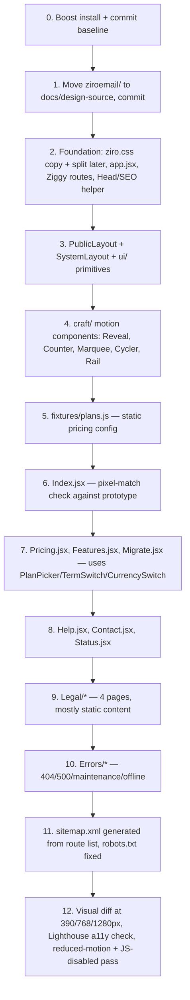
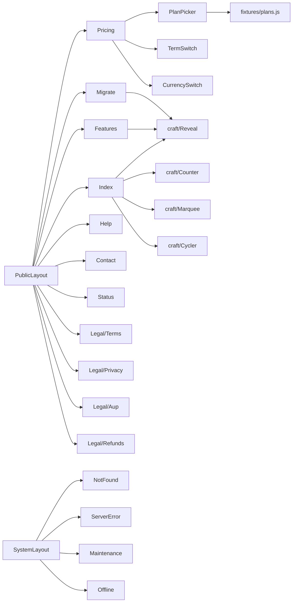

# Ziroemail — Marketing Build Spec (Phase 1a/1b)

Status: approved to start · Supersedes §10 of `ARCHITECTURE.md` with final decisions · Scope: public marketing + system pages only, on fixtures, no backend

This document exists so each build phase can be worked in isolation — load this file and the relevant page specs, not the full `ARCHITECTURE.md`, when driving the marketing build. Dashboard/backend work gets its own document when we reach it.

---

## 1. Decisions locked in (was §10 of ARCHITECTURE.md)

| # | Question | Decision |
|---|---|---|
| 1 | Pricing model (per-seat vs per-domain) | **Deferred.** Build with the UI's per-domain/pooled model as placeholder config, reversible later. Not a blocker — see §4.5 rule carried over below. |
| 2 | Install Laravel Boost first? | **Yes, recommended** — run `composer require laravel/boost --dev && php artisan boost:install` before any app code lands. |
| 3 | Commit `ziroemail/`? | **Yes** — move to `docs/design-source/` and commit, so the static prototype stays a referenceable source of truth in-repo. |
| 4 | Styling approach | **Port `ziro.css` verbatim**, componentise around it. No Tailwind rewrite. Tailwind preflight disabled. |
| 5 | Photography | **Self-host** the Unsplash images with licence notes; no hot-linking. |
| 6 | SSR for public pages | **Defer.** `<Head>` tags only for now; revisit when organic search is a real channel. |
| 7 | Webmail backend | **Direct IMAP behind an interface** — not relevant to this phase, recorded for when we reach §5.5 in the dashboard/backend doc. |
| 8 | `onboard-plan.html` / `admin-storage.html` | Carry both forward as live screens (dashboard phase); not part of this phase. |

**Framework confirmed:** Inertia + React 19, per `ARCHITECTURE.md` §4.1–4.2. No alternative considered.

**Working method for the whole project:** build systematically, one surface at a time, so we're never holding the full spec in context.
1. **Marketing/public + system pages** (this document) — frontend only, fixtures/config for data, no DB.
2. **Dashboards** (owner, webmail, ops) — once marketing is done, we scope the Laravel backend (`ARCHITECTURE.md` §5) and wire real data behind what this phase built.

---

## 2. Scope of this phase

Pulled from `ARCHITECTURE.md` §3.1 and §9 (steps 1a + 1b), **marketing and system screens only**:

| Group | Screens |
|---|---|
| Public marketing | index, pricing, features, migrate, help, contact |
| Legal | terms, privacy, aup (acceptable use policy), refunds |
| Status | status |
| System states | 404, 500, maintenance, offline |

That's **14 screens**. Explicitly **out of scope** for this phase: signup/login/2FA/checkout (auth group), onboarding wizard, owner dashboard, webmail, ops console, device setup — all of those need either auth scaffolding or real data and are deferred to the dashboard phase.

### Out of scope, called out so it isn't accidentally built early
- No database migrations beyond what already exists (`users`, `cache`, `jobs`).
- No Sanctum auth wiring.
- No real `plans` table — pricing numbers are a static config array for this phase (see §5).
- No Mailcow/Paystack/SES integration code.

---

## 3. Directory structure for this phase

Only the subset of `ARCHITECTURE.md` §4.2 needed for marketing + system pages:

```
resources/
  css/
    ziro.css                  ← copied verbatim from ui/assets/css/ziro.css
    app.css                   ← @import ziro.css; tailwind theme/utilities only (no preflight)
  js/
    app.jsx                   ← createInertiaApp, layout resolver, progress bar
    Layouts/
      PublicLayout.jsx        ← .hdr + mobile nav sheet + footer
      SystemLayout.jsx        ← 404/500/maintenance/offline
    Components/
      ui/                     ← Button, Pill, Card, Banner, Field, Select, Stat, Table, Empty, Skeleton, Spinner, Tick, Logo
      craft/                  ← Marked, Ringed, Shape, Rise, Cycler, Counter, Marquee, Rail, Reveal
      domain/
        PlanPicker.jsx         ← pricing only, reads from fixtures/plans.js
        TermSwitch.jsx
        CurrencySwitch.jsx
    Hooks/
      useReveal.js  useCopy.js  useReducedMotion.js
    Lib/
      money.js                ← format NGN/USD, display only
    fixtures/
      plans.js                ← the only "data" this phase needs — static plan config
    Pages/
      Public/   Index.jsx  Pricing.jsx  Features.jsx  Migrate.jsx  Help.jsx  Contact.jsx  Status.jsx
      Legal/    Terms.jsx  Privacy.jsx  Aup.jsx  Refunds.jsx
      Errors/   NotFound.jsx  ServerError.jsx  Maintenance.jsx  Offline.jsx
public/
  images/                     ← logo PNGs, favicon, apple-touch-icon, og image, self-hosted photography
  robots.txt  sitemap.xml
docs/
  design-source/              ← ziroemail/ moved here per decision #3
```

Deliberately **not created yet** in this phase: `Layouts/AuthLayout`, `OnboardingLayout`, `DashboardLayout`, `MailLayout`, `OpsLayout`; `Pages/Auth`, `Checkout`, `Setup`, `Onboarding`, `Dashboard`, `Mail`, `Ops`; `PoolAllocator`, `DnsRecordRow`, `DomainSwitcher`, and anything else tied to real accounts or data.

---

## 4. Build sequence



Rationale for the order: layout + primitives + craft components unlock every page at once (per `ARCHITECTURE.md` §9, "steps 1b–1f can proceed in parallel after 1a" — here it's sequential within 1b since one person is building). Index is built and pixel-matched first as the proof that the port approach (verbatim CSS, no Tailwind reset fights) actually works before the rest are templated off it. Pricing comes next specifically because it's the only page needing fixture data and the `PlanPicker` family of components — getting that pattern right early de-risks the dashboard phase, which reuses the same "props/fixtures now, server later" contract.

## 5. Pricing in this phase (placeholder, not a decision)

Per decision #1, the pricing model question is **not being resolved now**. To build without blocking on it:

- `resources/js/fixtures/plans.js` holds the UI's per-domain/pooled numbers (Starter ₦1,000→₦1,100, Business ₦2,300→₦2,500, Premium ₦4,500→₦5,000; 10/30/100 GB pool) as the working placeholder, shaped exactly like the future Spatie `Data` class would return it.
- `PlanPicker`, `TermSwitch`, `CurrencySwitch` read only from this fixture — no page hard-codes a price.
- When the pricing model is actually decided (seat vs domain), only `fixtures/plans.js` changes shape; no page markup changes. This is the same reversibility rule as `ARCHITECTURE.md` §4.5 rule 1, just scoped to fixtures instead of DB.
- Copy rules still apply: product name is **Ziroemail** (one word), annual offer is stated as the lower monthly rate, never "2 months free".

## 6. Component map for this phase



---

## 7. Carried-over rules (still binding in this phase)

From `ARCHITECTURE.md` §4.4–4.5, the ones that actually apply to marketing pages:

1. No inline `<style>` in JSX — everything through `ziro.css` partials or component-scoped styles.
2. No `.html` links — Ziggy `route()` only.
3. Reveal-on-scroll must degrade safely: content visible by default, class added by JS, 2.5s fallback, re-created correctly across Inertia navigations.
4. `prefers-reduced-motion` honoured in every `craft/*` component.
5. Accessibility per `DESIGN.md` §7: skip link, focus ring, `aria-label` on icon buttons, `scroll-margin-top`, `tabular-nums`.
6. SEO: `<Head>` wraps title/description/canonical/OG/Twitter; a `JsonLd` helper replaces the hand-pasted blocks; `sitemap.xml` generated, not hand-maintained.

## 8. Exit check for this phase

Before moving to the dashboard/backend document:

- All 14 screens exist as Inertia pages behind real routes.
- Side-by-side visual diff against the static prototype at 390 / 768 / 1280 px passes for every screen.
- No inline `<style>`, no `.html` links, no dead `data-*` hooks.
- `npm run build` succeeds; Lighthouse accessibility ≥ the prototype's own score.
- Reduced-motion and JS-disabled pass: content readable, nothing hidden.
- `ziroemail/` is committed at `docs/design-source/`, Boost is installed.

When this is green, we write the dashboard/backend document — `ARCHITECTURE.md` §5 (data model, modules, tenancy) scoped down the same way this one scopes §4, plus the pricing-model decision gets made for real before `plans` becomes a DB table.

---

## Kickoff prompt

Paste this into Claude Code (or a fresh session with repo access) to start the build:

> We're starting the Ziroemail marketing build. Read `docs/ARCHITECTURE.md` for full context and `docs/MARKETING_BUILD.md` for this phase's locked-in decisions and scope — follow `MARKETING_BUILD.md` as the authoritative scope for what to build right now; `ARCHITECTURE.md` is background only for this phase.
>
> Do these in order, confirming each step works before moving to the next:
> 1. Run `composer require laravel/boost --dev && php artisan boost:install`.
> 2. Move `ziroemail/` to `docs/design-source/` and commit as the baseline.
> 3. Set up the frontend foundation: copy `ziro.css` verbatim into `resources/css/`, wire `app.jsx`, disable Tailwind preflight, set up the Ziggy route map and a `Head`/`JsonLd` helper.
> 4. Build `PublicLayout` and `SystemLayout`, plus the `ui/` and `craft/` component sets listed in `docs/MARKETING_BUILD.md` §3 and §6.
> 5. Create `resources/js/fixtures/plans.js` with the UI's per-domain pricing numbers as placeholder data.
> 6. Build `Pages/Public/Index.jsx` first and pixel-diff it against the static prototype at 390/768/1280px before building anything else off it.
> 7. Then build Pricing, Features, Migrate, Help, Contact, Status, the four Legal pages, and the four system/error pages, in that order.
> 8. Generate `sitemap.xml` from the route list and fix `robots.txt`.
> 9. Run the exit check in `docs/MARKETING_BUILD.md` §8 before declaring this phase done.
>
> Do not build auth, checkout, onboarding, dashboards, webmail, or ops in this phase — those wait for the next document. Do not create a real `plans` database table — pricing stays in the fixture for now. Ask me before making any decision not already covered in `docs/MARKETING_BUILD.md` or `docs/ARCHITECTURE.md`.
